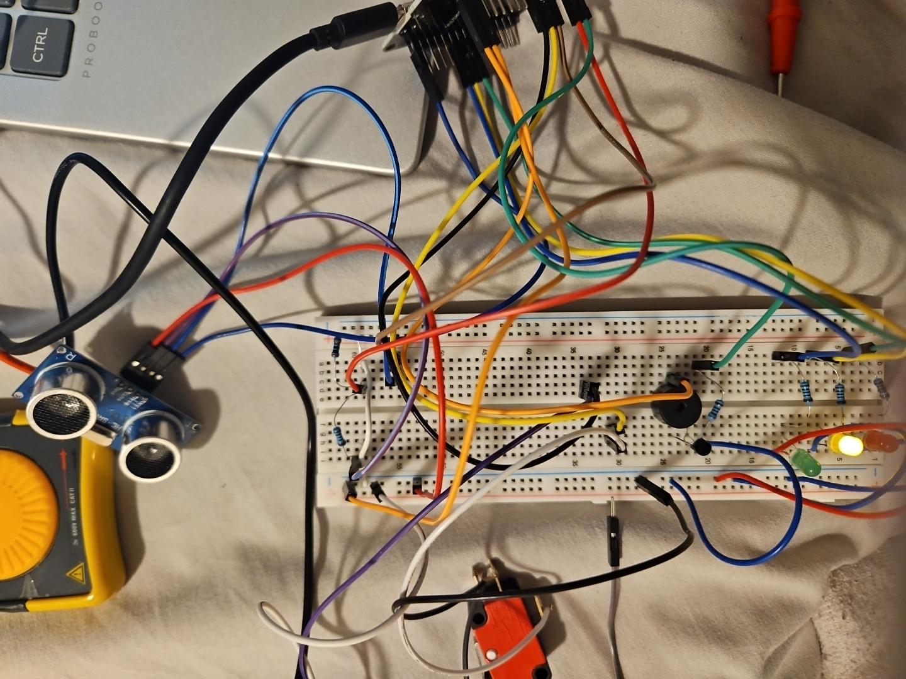

# Banc de validation embarqué ESP32

<p align="center">
  
</p>

Suite de firmwares ESP-IDF écrits en C pour tester séparément les entrées, capteurs et actionneurs d’un petit volet de ventilation. L’application complète n’est pas encore intégrée : chaque dossier reste un projet autonome.

## Contenu

| Projet | Fonction | Résultat observé |
| --- | --- | --- |
| [`tp02_gpio_nvs`](tp02_gpio_nvs/main/tp02_gpio_nvs_main.c) | LED sur GPIO18, logs et compteur de démarrages en NVS | compile ; la révision NVS doit encore être reflashée |
| [`tp03_i2c`](tp03_i2c/main/tp03_i2c_main.c) | BME280 en I2C, SDA21 / SCL22, adresse `0x76` | capteur `0x60` détecté, mesures enregistrées |
| [`tp04_gpio`](tp04_gpio/main/tp04_gpio_main.c) | fins de course 18/19, LED 25/26/27, buzzer 23 | quatre états et rebonds testés |
| [`tp05_gpio`](tp05_gpio/main/tp05_gpio_main.c) | HC-SR04, TRIG21 / ECHO22, timeout de 30 ms | distances valides et défaut ECHO testés |
| [`tp06_servo`](tp06_servo/main/tp06_servo_main.c) | servo 50 Hz sur GPIO13 avec fins de course | fermeture détectée une fois ; ouverture encore instable |

Le signal ECHO du HC-SR04 passe par un pont diviseur 5 V vers 3,3 V. Le servo utilise une alimentation 5 V séparée avec masse commune.

## Logique de validation

Le travail est organisé par interface :

1. faire fonctionner un périphérique seul ;
2. vérifier les mesures ou les transitions dans le moniteur série ;
3. traiter les valeurs invalides et les timeouts ;
4. seulement ensuite préparer l’intégration.

Les essais ont notamment couvert les rebonds des fins de course, l’état contradictoire, un ECHO bloqué et la coupure PWM après timeout. Les dernières versions de TP02, TP05 et TP06 compilent mais demandent encore une validation complète sur le montage.

## Compiler

ESP-IDF `v6.1-beta1` a été utilisé avec la cible `esp32`. Depuis le dossier d’un TP :

```text
idf.py set-target esp32
idf.py build
idf.py -p COMx flash monitor
```

## Médias

- [Essai du banc — vidéo 1, 15 s](docs/videos/essai-banc-01.mp4)
- [Essai du banc — vidéo 2, 8 s](docs/videos/essai-banc-02.mp4)

## À faire

- fiabiliser la détection de la position ouverte ;
- regrouper les blocs dans une machine à états ;
- ajouter des scénarios de test reproductibles et une trace résultat/exigence.

## Code tiers

TP03 utilise l’API BME280 de Bosch Sensortec v3.5.1 sous licence BSD 3-Clause. Voir [`THIRD_PARTY_NOTICES.md`](THIRD_PARTY_NOTICES.md).
