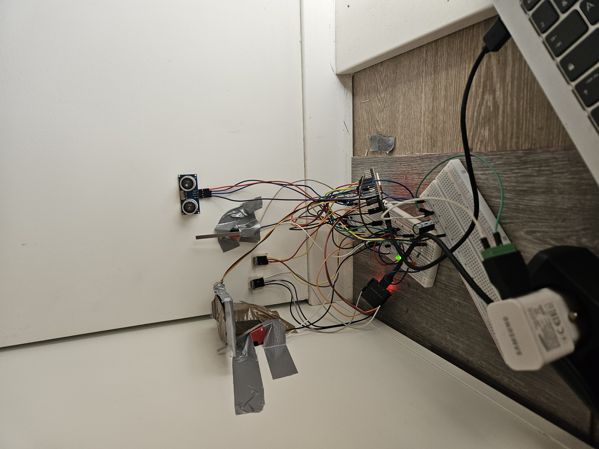
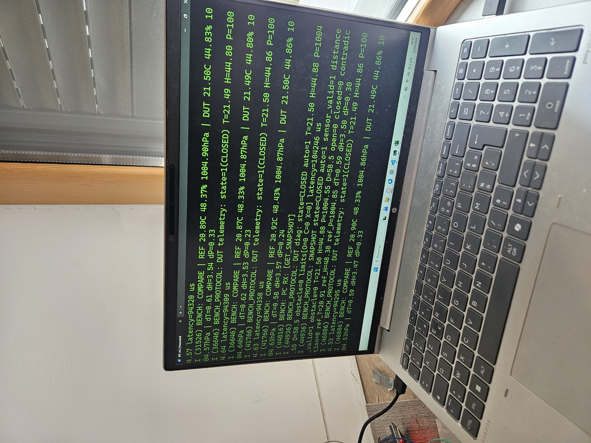

# Volet de ventilation sur ESP32 et banc de validation

J'ai réalisé une maquette de volet qui s'ouvre et se ferme selon la température et l'humidité.
Un premier ESP32 commande le mécanisme ; un second sert de banc de test, avec son propre capteur
de référence. Depuis le PC, je peux envoyer des commandes, suivre les mesures et enregistrer les essais.

**C · Python · ESP-IDF 6.1 · FreeRTOS · UART · I2C**

## Démonstration

[**Voir la vidéo du projet — 41 secondes**](media/demonstration-volet.mp4)

<table>
  <tr>
    <td></td>
    <td></td>
  </tr>
  <tr>
    <td>Le montage sur plaque d'essai.</td>
    <td>Les mesures et les écarts suivis depuis le PC.</td>
  </tr>
</table>

## Fonctionnement

```text
BME280, HC-SR04, fins de course
              │
        ESP32 DUT → servo, LED, buzzer
              │ UART
        ESP32 BENCH + BME280 de référence
              │ USB
        Superviseur Python → rapports d'essai
```

Le DUT est la carte qui pilote le volet. Le mode automatique utilise une hystérésis : ouverture
à partir de **26 °C ou 70 % d'humidité**, fermeture à **25 °C et 65 %**. Un obstacle pendant la
fermeture déclenche une réouverture. Un mouvement trop long, des fins de course contradictoires
ou des erreurs capteur répétées déclenchent l'arrêt `SAFE`.

Le BENCH interroge le DUT et compare ses mesures à celles du second BME280. Le superviseur Python
enregistre les états et produit des rapports JSON, CSV, HTML et Excel.

## Ce que j'ai travaillé

J'ai d'abord testé les périphériques séparément, puis intégré la machine à états, les tâches
FreeRTOS et la communication entre les deux cartes. Les essais simulés (SIL) m'ont servi à vérifier
les scénarios avant les essais sur matériel (HIL).

L'intégration m'a notamment amené à corriger la réception de commandes UART fragmentées, à protéger
les transactions du banc par mutex et à transmettre explicitement les contradictions des fins de
course à la machine à états.

## Résultats

- **39 tests Python** couvrent les scénarios, les erreurs de communication et les rapports.
- La [campagne matérielle du 10 octobre 2026](tp16_5_final_integration/reports/demo_20261010_124952.json)
  contient **120 mesures**, un cycle d'ouverture/fermeture et un résultat global `PASS`.
- Les [journaux série](tp16_5_final_integration/evidence/demo_serial_20261010_124952.log) et le
  [périmètre de validation](tp16_5_final_integration/docs/ACCEPTANCE_CHECKLIST.md) accompagnent les résultats.

Il s'agit d'une maquette sur plaque d'essai. Le protocole UART utilise un contrôle XOR, sans
authentification cryptographique.

## Code et documentation

La **[version intégrée](tp16_5_final_integration/)** regroupe les deux firmwares, le superviseur et
les instructions de compilation et de lancement.

| Dossiers | Étape du projet |
|---|---|
| `tp02` à `tp06` | GPIO, NVS, capteurs, servo et fins de course |
| `tp07` à `tp09` | Machine à états, FreeRTOS et protocole UART |
| `tp10` à `tp11_5` | Supervision Python et intégration des deux ESP32 |
| `tp12` à `tp16` | Injection de défauts, campagnes SIL/HIL et traçabilité |

Le [câblage](tp16_5_final_integration/docs/WIRING.md) précise les broches, l'adaptation du signal ECHO
du HC-SR04 et l'alimentation du servo. Les [tests logiciels](.github/workflows/sil-tests.yml) sont
exécutés par GitHub Actions. Le pilote BME280 de Bosch est référencé dans les
[notices de code tiers](THIRD_PARTY_NOTICES.md).
